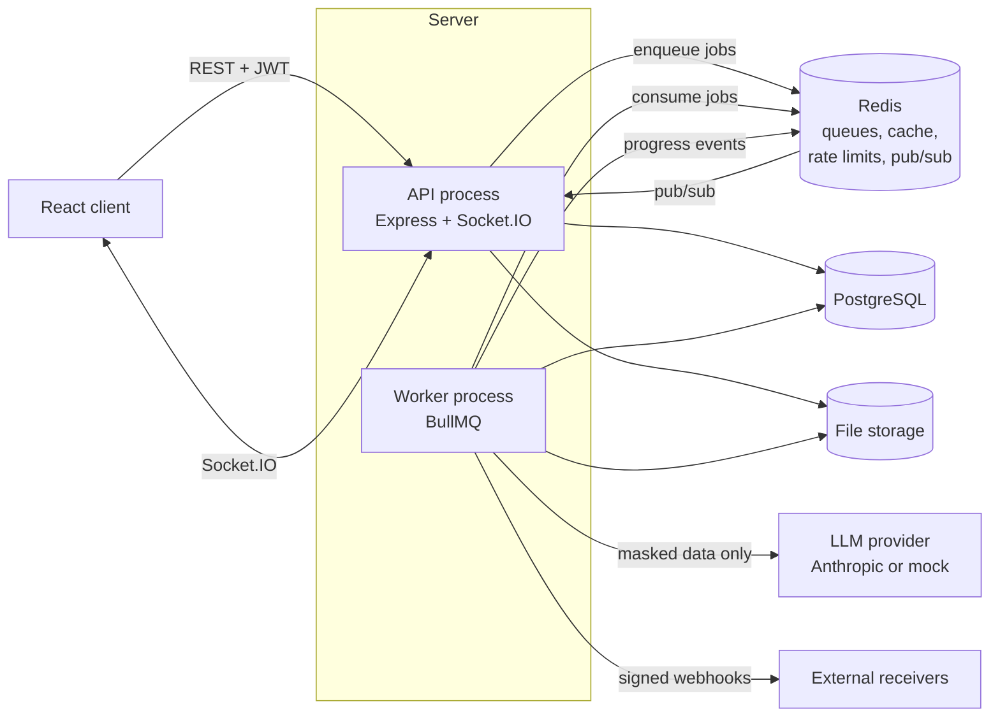
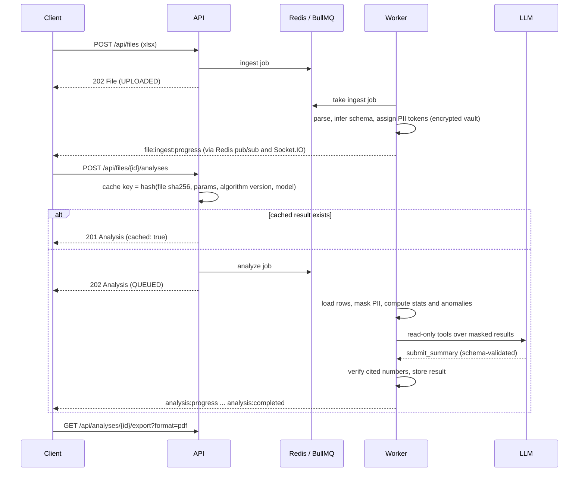

# FinAgent

FinAgent is a backend for an analysis assistant that helps bank employees work with Excel workbooks.
An employee uploads a workbook of any shape. FinAgent parses it, infers the schema, computes statistics
and detects anomalies **deterministically in code**, masks personal data, and then lets a language model
write a structured summary with recommendations. The model only narrates facts the code computed. The
result can be exported as an Excel or PDF report, and progress is streamed live over WebSocket.

```
finagent/
  server/   Node.js + TypeScript API and background worker (this repository's backend)
  client/   React client (planned, not part of this repository yet)
  docs/     OpenAPI document, dependency notes, concepts map
```

## The problem

Bank teams receive transaction exports, ledgers and reports as spreadsheets with inconsistent layouts.
Reviewing them by hand is slow, and pasting them into a general-purpose chatbot is not acceptable: the
numbers can be invented and customer data leaves the bank's control. FinAgent keeps the arithmetic in
auditable code, keeps personal data masked, and uses the model only for the narrative.

## Features

- **Upload** `.xlsx` / `.csv` with content verification (magic bytes, zip structure, zip-bomb guard),
  size/sheet/row limits and idempotent re-uploads (same user + same bytes returns the existing file).
- **Ingest** in a background worker: header detection (titles above the table, blank rows, merged
  cells, repeated headers), column type inference (number, currency, percent, date, boolean, id, text).
- **Statistics** per column: sum, mean, median, min/max, standard deviation, percentiles, top values,
  date ranges and gaps, null rates.
- **Anomaly rules**, one file each: statistical outliers (IQR and z-score), exact and near duplicates,
  round-amount clustering, structuring below a reporting threshold, weekend/off-hours activity and
  bursts, Benford first-digit deviation, data-quality problems.
- **PII masking**: Azerbaijani FIN, IBAN (mod-97 checked), payment cards (Luhn checked), phone numbers,
  emails and names (English and Azerbaijani column headers) become stable tokens such as `[PERSON_3]`.
  The token map is stored encrypted (AES-256-GCM).
- **Summary agent**: a bounded tool-use loop with read-only tools over masked data, a schema-validated
  `submit_summary` output in English or Azerbaijani, and a number check that flags any cited figure not
  found in the computed results.
- **Reports**: Excel and PDF export with a methodology section and formula-injection protection.
- **Real time**: Socket.IO events for ingest and analysis progress, driven from the worker through Redis.
- **Webhooks**: HMAC-signed `analysis.completed` / `analysis.failed` deliveries with retries and SSRF protection.
- **Security**: JWT access tokens with rotating refresh tokens, lockout, role-based access control,
  Redis-backed rate limits and an append-only audit log.

## Architecture



### One analysis, step by step



## Privacy and security design

- **The LLM never sees raw PII.** Rows are masked with the file's token vault before statistics, anomaly
  detection and every agent tool run. Tokens are stable within a file, so duplicates and top payees still
  show up. Original values are shown only through `GET /api/files/{id}/rows?unmask=true`, which is limited
  to managers and admins and audited as `pii.unmask`.
- **Numbers come from code.** The model can only call read-only tools that return computed results, and
  its summary must pass a Zod schema. Cited numbers are cross-checked; unverified ones become caveats.
- **Prompt-injection defence.** Cell content is wrapped in `<workbook_data>` delimiters (with any delimiter
  inside a cell defused), the system prompt states that this content is data and never instructions, and
  no tool can write, delete or reach the network.
- **Audit.** Logins (successful and failed), user and role changes, uploads, views, deletions, analyses,
  exports, unmasking and webhook changes are recorded with actor, IP and user agent. The table is
  append-only at the database level (a trigger rejects UPDATE and DELETE), and entries are written in the
  same transaction as the change they describe.
- **RBAC.** `ANALYST` sees only their own files; `MANAGER` sees and exports all files; `ADMIN` additionally
  manages users, webhooks and audit logs. Files outside a user's scope return 404 so ids cannot be probed.
- **Sessions.** 15-minute access tokens; single-use refresh tokens stored as SHA-256 hashes; reuse of a
  rotated refresh token revokes the whole session family. Accounts lock temporarily after repeated failures.
- **SSRF.** Webhook URLs must be https (http only outside production), may not carry credentials, and may
  not resolve to private, loopback or link-local addresses. The check runs again at connect time through
  a custom DNS lookup, and redirects are not followed, so DNS rebinding cannot bypass it.
- **Uploads.** Files are stored under random names (never the original name), verified by content, and
  checked for decompressed size before parsing.
- **Exports.** Any cell beginning with `=`, `+`, `-` or `@` is neutralised in Excel reports.

## Quick start (local development)

Prerequisites: Node.js 22+, Docker.

```bash
cp .env.example .env                 # local-dev placeholders; replace secrets outside development
docker compose up -d db redis        # Postgres 16 (+ finagent_test database) and Redis

cd server
npm install                          # also generates the Prisma client
npm run db:migrate                   # apply migrations to the dev database
npm run db:seed                      # demo users: admin / manager / analyst (see .env.example)
npm run dev                          # API on http://localhost:3000 and the worker, with reload
```

If Postgres or Redis already run natively on your machine, change `DB_HOST_PORT` / `REDIS_HOST_PORT`
and the matching URLs in `.env`.

Run the end-to-end smoke test against the running API and worker (with `LLM_PROVIDER=mock`):

```bash
cd server
npm run smoke
```

It logs in as the seeded analyst, uploads a synthetic workbook, waits for ingest, runs an analysis,
downloads both report formats and prints PASS/FAIL per step.

To use Anthropic instead of the mock provider, set `LLM_PROVIDER=anthropic` and `ANTHROPIC_API_KEY` in
`.env`. The default model is configured with `LLM_MODEL`.

### Full stack in containers

```bash
docker compose up --build            # db, redis, one-off migrate job, api, worker
```

## API

- Interactive documentation: **http://localhost:3000/docs** (Swagger UI)
- Machine-readable: `GET /docs/openapi.json`, also committed as [`docs/openapi.json`](docs/openapi.json)
  (generated from the Zod schemas with `npm run openapi:export`; a test fails if it is out of date).
  Postman and most client generators can import this file directly.

| Area | Endpoints |
| --- | --- |
| Health | `GET /health`, `GET /ready` |
| Auth | `POST /api/auth/login`, `POST /api/auth/refresh`, `POST /api/auth/logout`, `GET /api/auth/me` |
| Users (admin) | `POST /api/users`, `GET /api/users`, `PATCH /api/users/{id}/role` |
| Files | `POST /api/files`, `GET /api/files`, `GET /api/files/{id}`, `GET /api/files/{id}/rows`, `DELETE /api/files/{id}` |
| Analyses | `POST /api/files/{id}/analyses`, `GET /api/files/{id}/analyses`, `GET /api/analyses/{id}`, `GET /api/analyses/{id}/charts` |
| Reports | `GET /api/analyses/{id}/export?format=xlsx\|pdf` |
| Webhooks (admin) | `POST /api/webhooks`, `GET /api/webhooks`, `DELETE /api/webhooks/{id}` |
| Audit (admin) | `GET /api/audit-logs` |

Responses use `{ "data": ..., "meta": { ... } }`; errors use
`{ "error": { "code", "message", "details", "requestId" } }`. Lists use cursor pagination
(`?cursor=&limit=`, next page in `meta.nextCursor`).

**Socket.IO**: connect with `auth: { token: <accessToken> }`. Events: `file:ingest:progress`,
`analysis:progress` (`{ stage: parsing | analyzing | summarizing | done, percent }`),
`analysis:completed`, `analysis:failed`. Users receive events for their own files; managers and admins
for all files.

**Webhook signatures**: each delivery carries `X-FinAgent-Timestamp` and
`X-FinAgent-Signature: sha256=<hex>`, the HMAC-SHA256 of `"<timestamp>.<raw body>"` with the secret shown
once when the webhook is created. Reject requests older than five minutes.

### Analysis caching

An analysis is reused when the file content (SHA-256), request parameters, `ALGORITHM_VERSION`, LLM
provider/model and anomaly threshold are all identical. **Invalidation rule:** bump `ALGORITHM_VERSION` in
`server/src/domain/analysis/engine.ts` whenever statistics or rules change; old cache keys then stop
matching.

### Chart data

`GET /api/analyses/{id}/charts[?sheetId=]` returns ready-to-render `ChartSpec` objects (bar, line,
histogram, pie) for a completed analysis (409 before that): anomalies by type and severity, a time series
(day, week or month buckets chosen from the date range), histograms of up to three numeric columns, top
values of up to two low-cardinality text columns, activity by hour and missing values per column. They are
computed in code from masked rows (never by the LLM), so labels may be tokens such as `[PERSON_3]`. Every
series has at most 200 points. Results are cached in Redis per analysis cache key and file; bump
`CHARTS_VERSION` in `server/src/domain/analysis/charts.ts` to invalidate.

## Testing

```bash
cd server
npm run typecheck && npm run lint && npm run format:check
npm run test:unit            # pure logic: parsing, inference, rules, masking, agent loop, reports
npm run test:integration     # HTTP, database, Redis, queues, Socket.IO (needs docker compose db + redis)
npm test                     # both
```

Integration tests use the separate `finagent_test` database and Redis DB 15, and refuse to reset anything
that is not local. Tests always use the mock LLM provider; the real API is never called. CI runs the same
steps plus a production build and a Docker build.

## Project structure

```
server/
  src/
    app.ts            Express app factory (used by tests)
    server.ts         HTTP + Socket.IO bootstrap, graceful shutdown
    worker.ts         BullMQ worker process
    config/env.ts     Zod-validated configuration
    lib/              logger, prisma, redis, errors, crypto, jwt, pagination, openapi, ssrf
    middleware/       requestId, auth, rbac, validate, rateLimit, errorHandler
    modules/          auth, users, files, analyses, reports, webhooks, audit, health
    domain/
      ingest/         upload inspection, xlsx/csv parsing, schema inference
      analysis/       statistics, anomaly rules (one per file), engine, verifyNumbers
      privacy/        PII detectors, masker, encrypted vault
      agent/          LLM providers (Anthropic, mock), tools, prompts, summary agent
    queue/            queue definitions and processors (ingest, analyze, webhook-delivery)
    realtime/         Socket.IO server and Redis pub/sub events
    storage/          storage interface and local-disk implementation
  prisma/             schema, migrations, seed
  scripts/            OpenAPI export, synthetic sample generator, smoke test
  test/               integration tests
docs/                 openapi.json, CONCEPTS.md, DEPENDENCIES.md
```

See [docs/CONCEPTS.md](docs/CONCEPTS.md) for a map of backend concepts to files and
[docs/DEPENDENCIES.md](docs/DEPENDENCIES.md) for why each dependency was chosen.

## Limits and known trade-offs

- Workbooks are loaded fully in memory during ingest (bounded by `UPLOAD_MAX_BYTES`,
  `UPLOAD_MAX_UNCOMPRESSED_BYTES` and `UPLOAD_MAX_ROWS`). The exceljs streaming reader was not used because
  it drops sheets depending on zip layout.
- Rows are stored as JSON per row in PostgreSQL. This keeps any workbook shape queryable without dynamic
  tables, at the cost of storage efficiency for very large files.
- Date-times are treated as wall-clock time exactly as written in the sheet (Excel has no time zone).
- Name detection relies on column headers; names inside free-text cells are not detected.
- Analysis results and reports contain masked tokens; unmasking is available for rows only.
- Upload deduplication checks before insert; two identical uploads at the same instant can both succeed.
- Local disk storage is the only storage implementation; the `Storage` interface is ready for S3/R2.

## Roadmap

- React client (`client/`) generating its API types from `docs/openapi.json`.
- S3-compatible storage, OpenTelemetry tracing, per-tenant configuration of thresholds and working hours.
